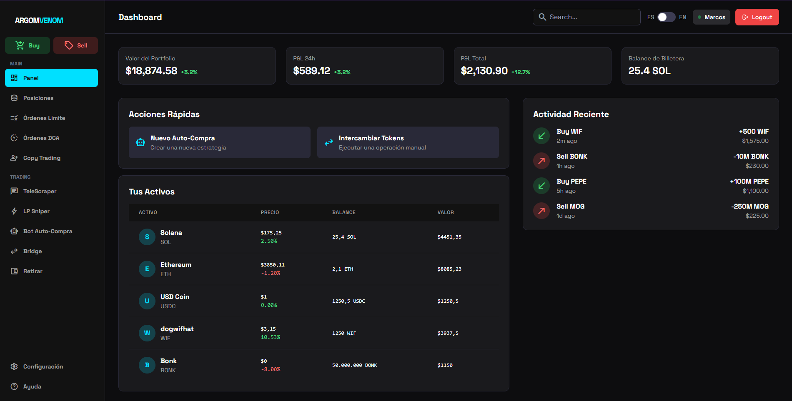

<div align="center">
  <h1> _-_-_ ARGOM VENOM _-_-_</h1>
  <h3>Trading Dashboard Profesional</h3>
  <p>
    Sistema de trading avanzado con <strong>Telegram scraper</strong> integrado
    para análisis de mercado en tiempo real
  </p>
</div>

<br />

<div align="center">
  <h2>--- Stack Tecnológico --- </h2>
</div>
<div align="center">
  <h2>Frontend</h2>

  <a href="https://reactjs.org/">
    
  </a>
  <a href="https://www.typescriptlang.org/">
    
  </a>
  <a href="https://tailwindcss.com/">
    
  </a>
  <a href="https://vitejs.dev/">
    
  </a>
  <a href="https://www.electronjs.org/">
    
  </a>
</div>

<br />

<div align="center">
  <h2>Backend & Automatización</h2>

  <a href="https://nodejs.org/">
    
  </a>
  <a href="https://gram.js.org/">
    
  </a>
  <a href="https://www.sqlite.org/">
    
  </a>
</div>

<br />

<div align="center">
  <h2>Integraciones</h2>

  <a href="https://core.telegram.org/api">
    
  </a>
  <a href="https://dexscreener.com/">
    
  </a>
</div>


---

## --- Descripción del Proyecto ---

**ARGOM VENOM** es un sistema de trading profesional diseñado para traders que necesitan una solución completa para monitorear señales de mercado, analizar tendencias de criptomonedas, gestionar operaciones y automatizar el análisis de grupos de Telegram en tiempo real.

## --- **Vista Principal del Sistema** ---

[](https://argom.azokia.com/)

*Haz clic en la imagen para acceder al sistema con usuario demo automático*

---

**Desarrollado por Edwin Estrella**

**Email:** edwinestrella67@gmail.com

---

## Tags
#Trading #Crypto #Dashboard #Telegram #Scraper #React #TypeScript #Electron #GramJS #TelegramAPI #CryptoTrading #MarketAnalysis #RealTime #Authentication #SQLite #NodeJS #ArgomVenom #TradingBot #MarketSignals #TokenAnalysis #DexScreener #PumpFun #Solana #Bitcoin #CryptoSignals #TradingDashboard #ProfessionalTrading

## ---Descripción del Proyecto---

**ARGOM VENOM** es un sistema de trading profesional diseñado para traders que necesitan una solución completa para monitorear señales de mercado, analizar tendencias de criptomonedas, gestionar operaciones y automatizar el análisis de grupos de Telegram en tiempo real.

## ---Características Principales---

### **Dashboard de Trading**
- **Visualización en Tiempo Real:** Gráficos y métricas actualizadas instantáneamente
- **Múltiples Pares:** Soporte para Bitcoin, Ethereum, Solana y más
- **Análisis Técnico:** Indicadores y herramientas de análisis integradas
- **Portafolio Dinámico:** Seguimiento de posiciones y ganancias/pérdidas
- **Alertas Personalizables:** Notificaciones para cambios de precio importantes

### **Telegram Scraper Inteligente**
- **Monitoría 24/7:** Escucha permanente de grupos de trading
- **Filtrado Avanzado:** Detección inteligente de señales relevantes
- **Keywords Configurables:** Busca términos específicos como DexScreener, Pump Fun
- **Grupos Pre-configurados:** Integración con CryptoEnfermosChat y más
- **Formateo Inteligente:** Detección automática de enlaces y patrones

### **Sistema de Autenticación Profesional**
- **Login Seguro:** Autenticación con credenciales encriptadas
- **Sesión Permanente:** Mantén tu sesión activa por 7 días
- **Panel de Control:** Gestión centralizada de usuario
- **Caché Local:** Almacenamiento seguro de sesiones
- **Logout Seguro:** Cierre de sesión con limpieza completa

### **Análisis y Reportes**
- **Métricas en Vivo:** Estadísticas de trading actualizadas
- **Historial Completo:** Registro de todas las operaciones
- **Exportación de Datos:** Compatible con Excel y CSV
- **Dashboard Personalizable:** Adapta la vista a tus necesidades

### **Interfaz Profesional**
- **Design Oscuro:** Optimizado para largas sesiones de trading
- **Responsive:** Compatible con desktop y tablet
- **Intuitivo:** Fácil navegación entre herramientas
- **Modo Fullscreen:** Maximiza tu espacio de análisis

## Stack Tecnológico

### **Frontend**
- **React 19.2** - Biblioteca de interfaz de usuario moderna
- **TypeScript** - Tipado estático y seguridad en el código
- **TailwindCSS** - Framework CSS utility-first
- **Vite** - Build tool ultra-rápido
- **Electron 38.4** - Aplicación desktop multiplataforma

### **Backend (proceso main de Electron)**
- **GramJS** - Cliente de Telegram (MTProto) en Node, sin Python
- **SQLite (`node:sqlite`)** - Base de datos local, sin módulos nativos
- **IPC tipado** - Contrato único en `shared/api.ts` entre main y la interfaz
- **safeStorage** - Cifrado de credenciales con el llavero del sistema

### **Integraciones**
- **Telegram API** - Acceso a grupos y mensajes
- **DexScreener API** - Datos de precios y volumen
- **Pump Fun** - Análisis de tokens emergentes
- **Twitter/X API** - Monitoría de influencers

## Desarrollo

Requisitos: Node.js 22 o superior.

```bash
npm install
npm run dev:electron   # app de escritorio con recarga en caliente
npm run dev            # solo la interfaz en el navegador (datos simulados)
npm test               # tests del backend (vitest)
npm run typecheck      # TypeScript del frontend y de electron/
npm run dist           # instalador para tu sistema operativo en release/
```

```
electron/
  main.ts                 ventana, arranque de servicios
  preload.ts              expone window.argom (API tipada) a la interfaz
  ipc.ts                  handlers IPC: verificación de origen y de sesión
  services/
    database.ts           SQLite + migraciones + ajustes clave/valor
    auth.ts               cuenta local, scrypt, "recordar", bloqueo
    secrets.ts            cifrado con safeStorage
    telegram/             GramJS, filtros, almacenamiento de mensajes
shared/api.ts             contrato IPC compartido (tipos y canales)
src/api.ts                cliente para la interfaz (y simulación en navegador)
```

Los datos se guardan en `argom-venom.db`, dentro de la carpeta de datos de la app (`%APPDATA%/argom-venom` en Windows).

## Arquitectura del Sistema

### **Módulos Principales**

#### **Módulo de Autenticación**
- Cuenta local creada en el primer arranque (contraseña con hash scrypt)
- Opción "mantener sesión iniciada" durante 7 días
- Bloqueo temporal tras 5 intentos fallidos

#### **Módulo Telegram Scraper**
- Conexión con Telegram usando GramJS dentro de la app (sin Python)
- Login con código y verificación en dos pasos desde la interfaz
- Monitoría de varios grupos con filtrado por palabras clave
- Detección de enlaces de DexScreener, pump.fun y X
- Historial de 14 días guardado en SQLite

#### **Dashboard Principal**
- Visualización de portafolio
- Gráficos de precios en tiempo real
- Indicadores técnicos personalizados
- Alertas y notificaciones

#### **Gestión de Configuración**
- Panel de configuración de API keys
- Gestión de grupos y keywords
- Personalización del dashboard
- Exportación de datos

## **Características de Interfaz**

### **Desktop Experience**
- **Pantalla Completa:** Aprovecha todo el espacio de tu monitor
- **Múltiples Ventanas:** Organiza tu workspace
- **Atajos de Teclado:** Navegación rápida y eficiente
- **Modo Oscuro:** Protege tu vista durante largas sesiones

### **Interactividad**
- **Arrastrar y Soltar:** Organiza tus widgets
- **Click Derecho:** Menús contextuales rápidos
- **Tooltips:** Ayuda contextual en tiempo real
- **Animaciones Suaves:** Transiciones profesionales

## **Seguridad y Privacidad**

ARGOM VENOM implementa medidas de seguridad enterprise:

- **Almacenamiento local:** todo vive en la carpeta de datos del usuario; no hay servidor
- **Contraseñas con hash:** scrypt con sal aleatoria, nunca en texto plano
- **Credenciales cifradas:** el API Hash y la sesión de Telegram se cifran con `safeStorage`
- **Sandbox:** renderer aislado (`contextIsolation`, `sandbox`, sin `nodeIntegration`) y CSP estricta
- **IPC protegido:** solo responde a la ventana de la app y exige sesión iniciada

## **Análisis y Métricas**

### **Trading Metrics**
- **Profit/Loss:** Ganancias y pérdidas en tiempo real
- **Win Rate:** Porcentaje de operaciones exitosas
- **Risk/Reward:** Relación riesgo-recompensa
- **Drawdown:** Análisis de pérdidas máximas

### **Telegram Analytics**
- **Message Frequency:** Frecuencia de mensajes por grupo
- **Keyword Detection:** Estadísticas de detección de patrones
- **Response Time:** Tiempo de respuesta a señales
- **Success Rate:** Efectividad de las señales detectadas

## **Personalización Avanzada**

### **Temas y Apariencia**
- **Modo Oscuro/Claro:** Cambia según tu preferencia
- **Acentos de Color:** Personaliza la interfaz
- **Tipografía:** Ajusta tamaños y fuentes
- **Layout Flexible:** Organiza los componentes a tu gusto

### **Configuración Trading**
- **Pares Personalizados:** Agrega tus cryptos favoritas
- **Alertas Configurables:** Define tus umbrales
- **Indicadores Técnicos:** Elige tus herramientas preferidas
- **Timeframes:** Múltiples intervalos de tiempo

## **Contacto y Soporte**

### **Desarrollador Principal**
- **Edwin Estrella** - Full Stack Developer & Trading Systems Architect

### **Información de Contacto**
- **Email:** edwinestrella67@gmail.com
- **GitHub:** @EdwinEstrella
- **Telegram:** @EdwinEstrella

### **Soporte Técnico**
- **Bug Reports:** Reporta problemas técnicos
- **Feature Requests:** Sugerencias de mejora
- **Documentación:** Guías y tutoriales
- **Training:** Capacitación personalizada

## **Licencia y Derechos**

Este proyecto es propiedad exclusiva de Edwin Estrella y está protegido por derechos de autor.

**Todos los derechos reservados © 2024 Edwin Estrella**

**Queda estrictamente prohibido:**
- La reventa o distribución comercial sin autorización
- La modificación del código fuente
- El uso para fines comerciales sin licencia
- La reversión de ingeniería

Para más información sobre licenciamiento, contactar directamente.

---

## **Agradecimientos Especiales**

Este proyecto fue desarrollado utilizando tecnologías de vanguardia y herramientas open source:

- **React** - Biblioteca de interfaz de usuario
- **TypeScript** - Superconjunto de JavaScript tipado
- **Electron** - Desarrollo de aplicaciones desktop
- **GramJS** - Integración con Telegram
- **TailwindCSS** - Framework CSS utility-first
- **Vite** - Herramienta de construcción ultra-rápida

---

## **Visión de Futuro**

ARGOM VENOM está en constante evolución con próximas características:

- **AI Trading Bot:** Automatización de estrategias
- **Mobile App:** Versión nativa para iOS/Android
- **Multi-Exchange:** Integración con más exchanges
- **Advanced Analytics:** Machine Learning para predicciones
- **Social Trading:** Copia de estrategias de traders exitosos

---

**Desarrollado con ❤️ y esfuerzo por Edwin Estrella**

*"Simplificando el trading de criptomonedas con tecnología de punta"*

---

**© 2024 - Todos los derechos reservados**
